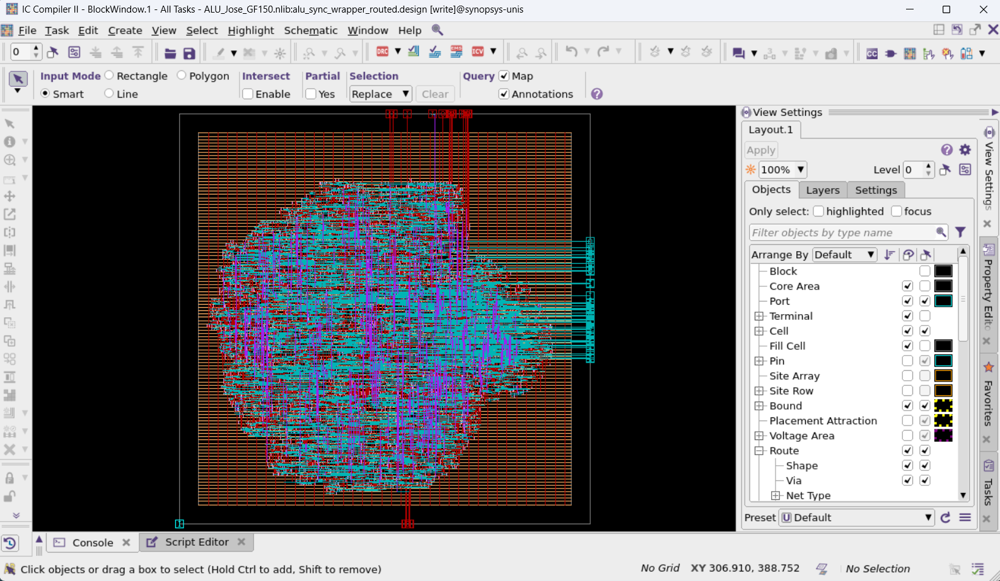
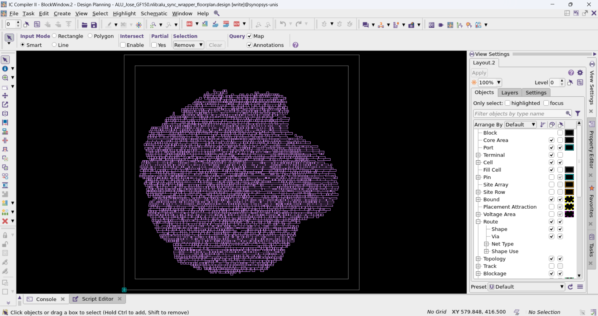
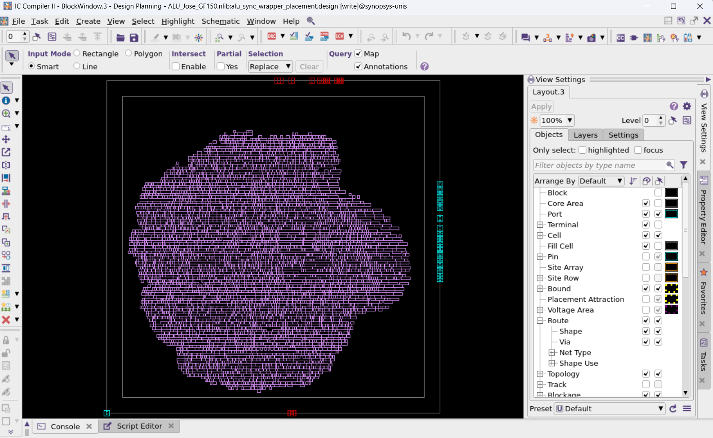
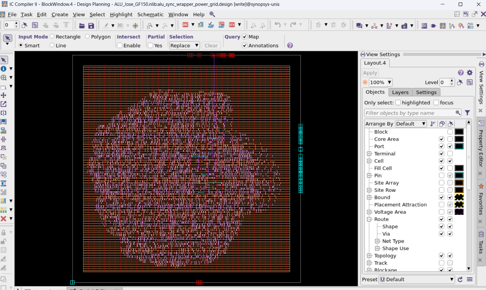
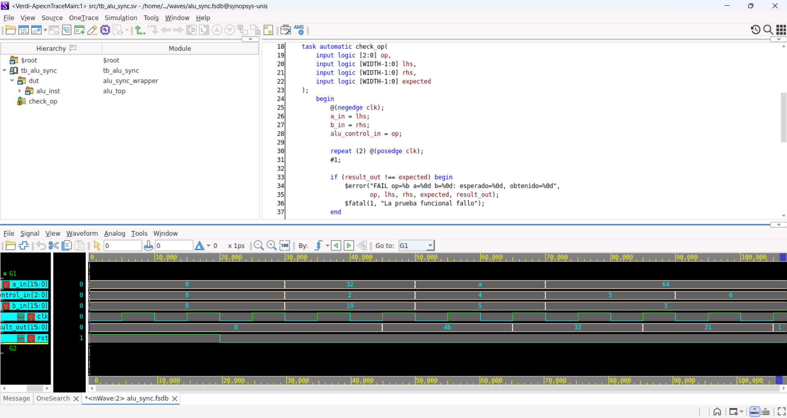
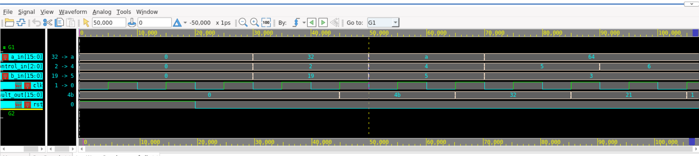

# Evidencia visual

## ICC2

### Layout final routed

Vista del bloque `alu_sync_wrapper_routed` después de routing, abierto en ICC2. Muestra la ubicación de celdas y las interconexiones del layout exportado. El reporte asociado registra 528 DRC y timing setup negativo; la captura documenta el resultado visual, no un signoff limpio.

### Floorplan

Vista del bloque `alu_sync_wrapper_floorplan`, antes de placement. El contorno y la distribución inicial de filas muestran la preparación del área central.

### Placement

Vista del bloque `alu_sync_wrapper_placement` tras placement. Las celdas estándar ocupan el core; consulta los reportes de placement para QoR y legalidad.

### Power grid

Vista del bloque `alu_sync_wrapper_power_grid` con la malla de alimentación y las celdas colocadas. La imagen complementa, pero no sustituye, los reportes de conectividad PG.

## Simulación VCS y Verdi

Las capturas siguientes muestran nWave con el FSDB de la simulación funcional. `alu_control_in` presenta 2, 4, 5 y 6 (hexadecimal); `result_out` presenta `4b`, `32`, `21` y `1`, equivalentes a 75, 50, 33 y 1 decimal. Los logs VCS registran los cuatro casos PASS.

